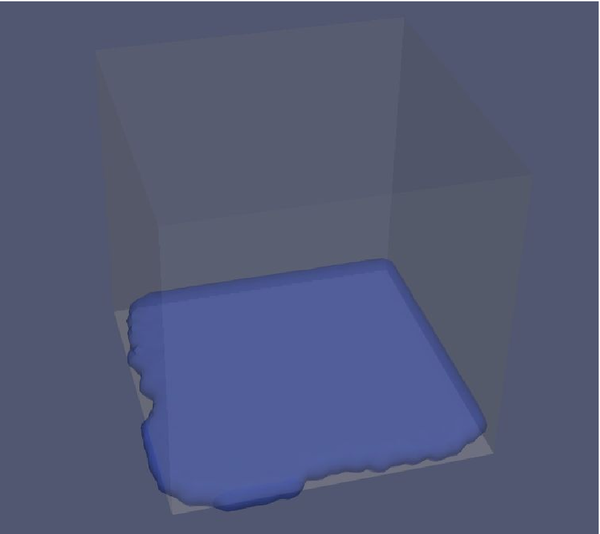
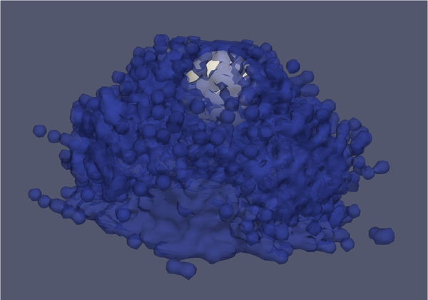
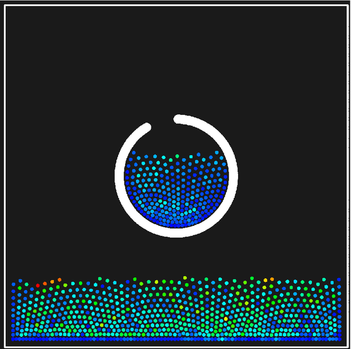

# SPH on GPUs

A Smoothed Particle Hydrodynamics (SPH) fluid solver written for the **High End Simulation in Practice (HESP, SS25)** mini-project at FAU Erlangen-Nürnberg. The solver follows Harada, Koshizuka & Kawaguchi, *Smoothed Particle Hydrodynamics on GPUs* (2007). It is written in CUDA, with a serial C++ reference version and two small real-time 2D viewers (OpenGL and Metal).

The CUDA version ran on the **NHR@FAU Alex** cluster on **NVIDIA A40 and A100** GPUs.

| Free fall of water | Flow over a sphere | 2D flow in a cup |
|:--:|:--:|:--:|
|  |  |  |
| 68,921 fluid + 540,548 boundary | 10,000 fluid + 839,258 boundary | 1,000 fluid + 3,927 boundary |
| dt = 1e-4, 5 s | dt = 1e-4, 5 s | dt = 6.25e-4 |

## What it does

Each time step:

1. **Neighbour search** using a hashed cell-linked list. On the GPU each particle is inserted with `atomicExch`, so the list is built without race conditions.
2. **Density** by summation with the poly6 kernel. **Pressure** from a linear equation of state, p = p₀ + k(ρ − ρ₀).
3. **Forces**:
   - pressure, using the spiky kernel gradient
   - viscosity, using the viscosity kernel Laplacian
   - gravity
4. **Explicit Euler** update of velocity and position.
5. **VTK output** every *n* steps, for viewing in ParaView.

Walls use stationary **ghost particles** combined with a **hybrid boundary condition**: when a fluid particle penetrates a ghost particle, it is pushed back out along the contact normal and the normal component of its velocity is removed. The slides in [`docs/slides.pdf`](docs/slides.pdf) contain the equations and diagrams.

## Layout

```
core/include/sph/   header-only physics shared by every backend (host + device)
backends/cuda/      sph_cuda   – one thread per particle
backends/cpu/       sph_cpu    – serial reference with the same physics
backends/opengl/    sph_opengl – real-time 2D viewer (GLFW + OpenGL 3.3)
backends/metal/     sph_metal  – real-time 2D viewer (metal-cpp, macOS)
tools/make_scene.py generates the 3D VTK scenes (fluid blob above an open-top box)
jobs/alex/          Slurm scripts for the A40 and A100 nodes of Alex
third_party/        vendored glad and metal-cpp
```

## Build and run

The CPU and CUDA executables share these options:

```
--scene box|cup|FILE.vtk   box = submitted 3D setup (default), cup = 2D, or a make_scene.py file
--fluid N                  fluid particles for generated scenes (default 10000)
--steps N  --dt DT  --every N  --out DIR
```

**CUDA on Alex**

```bash
module load cuda
cmake -S . -B build -DSPH_CUDA=ON -DSPH_CPU=OFF
cmake --build build -j
sbatch jobs/alex/a100.sbatch --scene box --out output/a100   # or jobs/alex/a40.sbatch
```

`CMAKE_CUDA_ARCHITECTURES` defaults to `80;86`, which covers both the A100 and the A40.

**CPU reference**

```bash
cmake -S . -B build && cmake --build build -j
./build/sph_cpu --scene box --fluid 1000 --steps 2000 --every 500
```

**3D scenes from VTK**

```bash
python3 tools/make_scene.py -o input/scene.vtk
./build/sph_cuda --scene input/scene.vtk
```

**2D viewers (macOS)**

Install GLFW first for the OpenGL viewer (`brew install glfw`).

```bash
cmake -S . -B build -DSPH_OPENGL=ON -DSPH_METAL=ON
cmake --build build -j
./build/sph_opengl        # space = pause, esc = quit
./build/sph_metal
```

## Changes since the submitted version

The code handed in for the course is tagged `hesp-ss25-submission`. This repo merges it with the OpenGL and Metal experiments, so that all of them share a single copy of the physics. Changes made during that merge:

- **Shared physics.** The kernels, neighbour search, forces and integration were written once in `core/` and are called by both the CUDA kernels and the CPU loops. Before this, the same code existed in about five copies.
- **Exactness check.** With the two numeric changes below reverted, the new core reproduces the original kernels to float rounding.
- **Hash slots visited once.** Neighbouring cells that hash to the same slot are now visited only once. Previously, particles in those cells were counted twice.
- **Numeric details.** π is now 3.14159 instead of 3.14, and cell coordinates use `floor` instead of truncation.
- **CPU forces counted once.** The serial and 2D versions now accumulate forces on `p` only, like the CUDA version. Before, they also applied every pair force to `q`, which counted every pair twice.

Older branches from both remotes are kept as `archive/*` tags.

## References

1. Harada, T., Koshizuka, S. and Kawaguchi, Y. (2007). *Smoothed particle hydrodynamics on GPUs*. Computer Graphics International, 40, 63–70.
2. Schechter, H. and Bridson, R. (2012). *Ghost SPH for animating water*. ACM Transactions on Graphics, 31(4).
3. Kelager, M. (2006). *Lagrangian fluid dynamics using smoothed particle hydrodynamics*. University of Copenhagen.
4. Tomasi, R. (2015). *Smoothed Particle Hydrodynamics*. LMU Munich.
5. HESP SS25 lecture notes, FAU Erlangen-Nürnberg.

## Authors

Vinay Kumar Reddy Patil and Aravind Krishnaprasad Saligram. Aravind wrote the scene generator in `tools/make_scene.py`.

Compute time was provided by NHR@FAU on the Alex GPU cluster.
